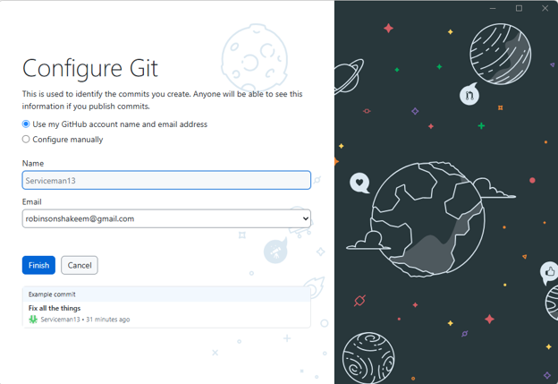
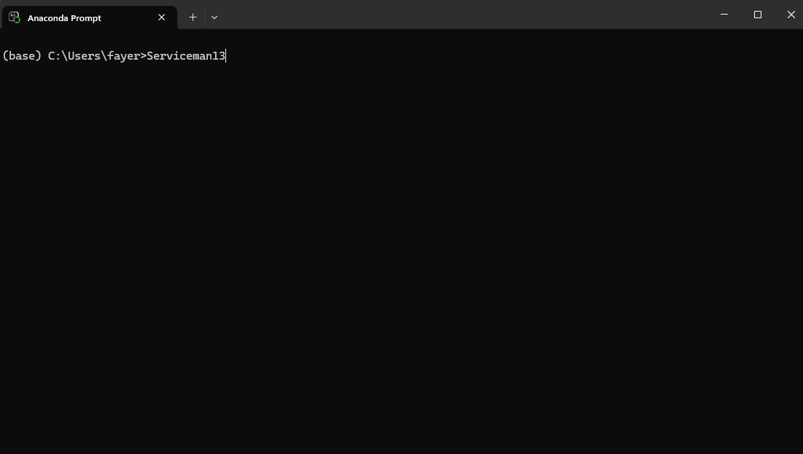
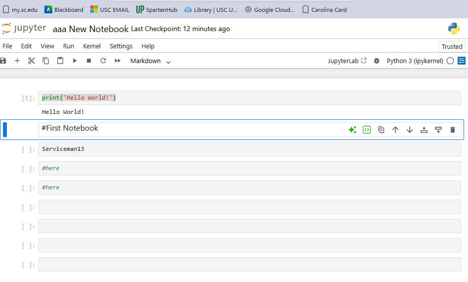
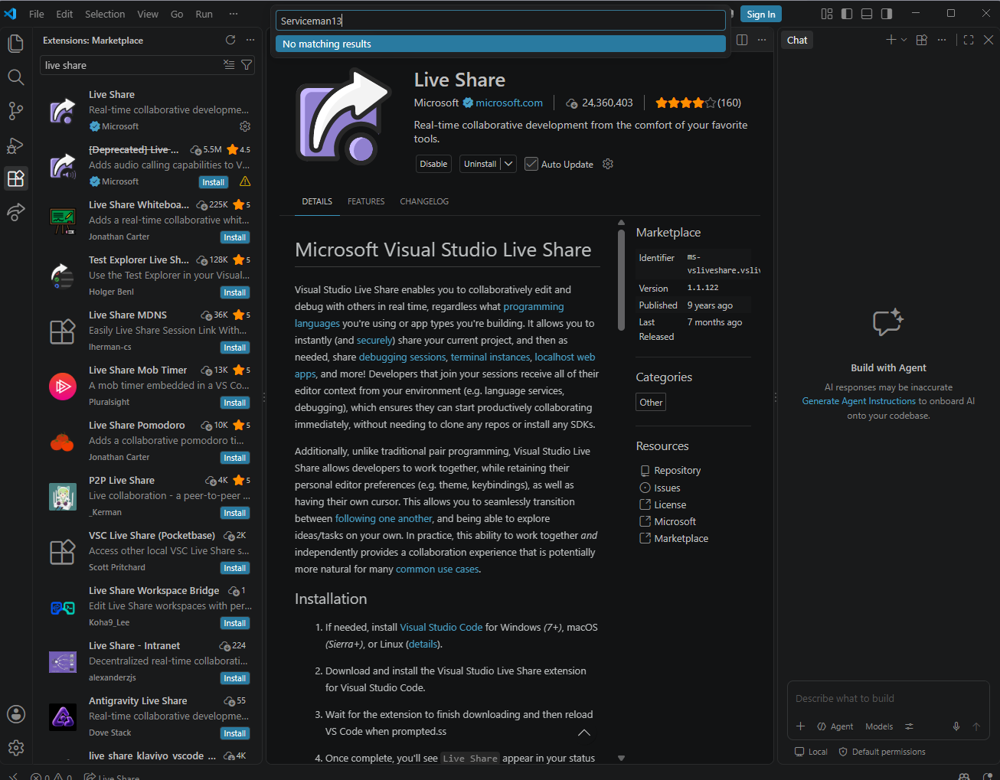

## Hello, I'm Shakeem 👋
I'm a student learning python. APIs, and interoperability tools. 

## 🔧 Tools & Languages
- Python
- Anaconda
- Jupyter Notebook
- VS Code
- Github

### Github

### Anaconda

### Jupyter

### VS Code

